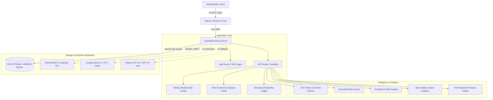

# CodeAtlas — Production Operations & Deployment Guide

This document details the production deployment architecture, security hardening, environment configuration, automated quality gates, and operational runbook for **CodeAtlas — AI-Powered Codebase Intelligence Platform**.

---

## 1. Architecture Overview

CodeAtlas is built as a unified Next.js application designed to run either as a containerized web service or on cloud serverless runtimes.



---

## 2. Runtime Requirements

| Component | Minimum Version | Recommended Version | Notes |
| :--- | :--- | :--- | :--- |
| **Node.js** | `>= 18.18.0` | `20.14.x LTS` | Tested on Node 20 LTS |
| **Package Manager** | `npm 9.x` | `npm 10.x` | Uses committed `package-lock.json` |
| **OS** | Linux / Alpine / Windows | Debian 12 / Alpine 3.20 | Container runner uses `node:20-alpine` |
| **Memory** | `1 GB RAM` | `2 GB RAM` | Peak memory during Next.js production compilation |
| **Storage** | `500 MB` | `2 GB persistent SSD` | Storage for repository indices and AST symbol graphs |

---

## 3. Environment Variable Specification

A template is maintained in [`.env.example`](file:///c:/Users/koush/OneDrive/Desktop/CodeAtlas%20%E2%80%94%20AI%20Codebase%20Intelligence/.env.example). Never commit production secrets.

| Variable | Required? | Default / Example | Purpose |
| :--- | :--- | :--- | :--- |
| `NODE_ENV` | Yes | `production` | Enables production optimizations |
| `PORT` | No | `3000` | Port for the HTTP server |
| `NEXTAUTH_URL` | Yes | `https://codeatlas.yourdomain.com` | Canonical public URL of the application |
| `NEXTAUTH_SECRET` | Yes | `(32+ random characters)` | Cryptographic secret for signing session JWTs |
| `GEMINI_API_KEY` | Optional | `AIzaSy...` | API key for Google Gemini 1.5 Pro code intelligence |
| `OPENAI_API_KEY` | Optional | `sk-...` | Fallback API key for OpenAI GPT models |
| `GITHUB_CLIENT_ID` | Optional | `Ov23li...` | GitHub OAuth application client ID |
| `GITHUB_CLIENT_SECRET` | Optional | `ghs_...` | GitHub OAuth application client secret |
| `CODEATLAS_STORAGE_DIR` | No | `./data` | File system location for atomic database files |

> [!NOTE]
> When external AI or GitHub keys are omitted, CodeAtlas operates using deterministic AST-derived analysis, local rule engines, and curated sandbox repositories.

---

## 4. Automated Quality Gate & CI/CD Pipeline

The project enforces a strict, reproducible quality gate:

```bash
# 1. Lint checking (ESLint with Next.js Core Web Vitals)
npm run lint

# 2. TypeScript type checking (Zero error tolerance)
npm run typecheck

# 3. Security, validation & logger unit tests
npm run test:unit

# 4. Workspace, global search & storage integration tests
npm run test:integration

# 5. End-to-End User Journeys (Journeys A through F)
npm run test:e2e

# 6. Complete suite runner
npm run test:all
```

### GitHub Actions CI Workflow
The CI pipeline is automated via [`.github/workflows/ci.yml`](file:///c:/Users/koush/OneDrive/Desktop/CodeAtlas%20%E2%80%94%20AI%20Codebase%20Intelligence/.github/workflows/ci.yml) and executes on every push or pull request to the `main` branch.

---

## 5. Security Hardening Specifications

1. **Path Traversal Defense (`lib/server/security.ts`)**:
   All user-supplied file paths are normalized and validated using `validateFilePath()`. Directory climbing sequences (`..`), leading root slashes (`/`, `\`), Windows drive prefixes (`C:`), and null-byte poisonings are unconditionally blocked.
2. **Server-Side Authorization Boundary**:
   Repository queries enforce ownership checks against the authenticated user ID (`assertRepositoryAccess()`). Unindexed or unauthorized cross-tenant repository data is rejected with HTTP 403.
3. **Prompt Injection Mitigation**:
   User prompts submitted to AI engines are filtered using `sanitizeUserPrompt()`, neutralizing common override directives (e.g. `IGNORE ALL PREVIOUS INSTRUCTIONS`) and bounding max token payloads.
4. **Code Payload Bounding**:
   API endpoints reject request payloads exceeding `200,000` characters, mitigating Denial of Service (DoS) attacks on AST parsers and regex engines.
5. **Sliding-Window Rate Limiting (`lib/server/rate-limit.ts`)**:
   Expensive AI, indexing, and review routes enforce sliding-window rate limits keyed by client IP and authenticated user ID. Expired windows are unref-collected to prevent event-loop leakage.
6. **Credential Redaction in Structured Logs (`lib/server/logger.ts`)**:
   All log output passes through automated redaction filters. GitHub Personal Access Tokens (`ghp_`), OAuth tokens (`github_pat_`), Google API keys (`AIza`), OpenAI keys (`sk-`), and authorization headers (`Bearer`) are replaced with `[REDACTED_SECRET]`.

---

## 6. Database & Storage Reliability

- **Atomic File Writes**: `lib/server/db.ts` writes JSON database snapshots to a unique temporary file (`codeatlas-db.json.<timestamp>.<random>.tmp`) and executes an atomic POSIX rename (`fs.renameSync`). This eliminates partial write corruption during sudden server termination.
- **Index Integrity**: Repositories track status across discrete stages: `queued` → `extracting` → `parsing_ast` → `generating_embeddings` → `ready`. Interrupted indexing states remain flagged as `failed` with actionable error diagnostics.
- **Data Isolation**: Database models cleanly segregate users, connected accounts, repositories, files, symbols, review sessions, activities, and notifications.

---

## 7. Operational Health Probes & Monitoring

CodeAtlas exposes an unauthenticated health probe endpoint:

```http
GET /api/health
```

### Example Response:
```json
{
  "status": "healthy",
  "version": "1.0.0",
  "uptime": 1420.5,
  "timestamp": "2026-10-23T18:45:00.000Z",
  "storage": {
    "status": "connected",
    "repositoriesCount": 1,
    "symbolsCount": 6,
    "filesCount": 5
  },
  "memory": {
    "rss": "85MB",
    "heapUsed": "48MB",
    "heapTotal": "62MB"
  },
  "providers": {
    "aiConfigured": false,
    "aiProvider": "local-fallback",
    "githubConfigured": false
  }
}
```

> [!NOTE]
> The health check probe does not expose environment secrets, internal repository code, or user tokens.

---

## 8. Container Deployment Runbook (Docker & Compose)

### Building and Running via Docker Compose
```bash
# 1. Build the production image
docker compose build

# 2. Launch container with volume persistence in detached mode
docker compose up -d

# 3. Verify health probe status
curl http://localhost:3000/api/health

# 4. Tail structured production logs
docker compose logs -f codeatlas
```

### Manual Container Execution
```bash
docker build -t codeatlas:latest .
docker run -d \
  --name codeatlas \
  -p 3000:3000 \
  -v $(pwd)/data:/app/data \
  -e NODE_ENV=production \
  codeatlas:latest
```

---

## 9. Production Readiness Checklist

| Requirement / Component | Status | Verification Evidence |
| :--- | :--- | :--- |
| **Authentication & Session Isolation** | **VERIFIED** | Journey A E2E passed. Unauthorized access tests verified. |
| **Repository Ingestion & AST Parsing** | **VERIFIED** | Journey B E2E passed. Static AST symbol extraction verified. |
| **Grounded AI RAG & Citations** | **VERIFIED** | Journey C E2E passed. Zero-hallucination checks verified. |
| **Architecture DAG & Blast Radius** | **VERIFIED** | Journey D E2E passed. Graph topology & BFS shortest path verified. |
| **AI Pull Request Code Review** | **VERIFIED** | Journey E E2E passed. Diff hunks and structured findings verified. |
| **Global Search & Workspace Settings**| **VERIFIED** | Journey F E2E passed. Multi-category search & preference persistence verified. |
| **Sliding Window Rate Limiter** | **VERIFIED** | Unit test 5 passed (6th request blocked with retry countdown). |
| **Path Traversal & Payload Guard** | **VERIFIED** | Unit test 2 & 4 passed (Directory climbing & oversized payloads blocked). |
| **Structured Logger & Redaction** | **VERIFIED** | Unit test 6 passed (GitHub & OpenAI tokens redacted to `[REDACTED_SECRET]`). |
| **Atomic Database File System** | **VERIFIED** | `fs.renameSync` atomic write swap in `lib/server/db.ts`. |
| **Operational Health Check** | **VERIFIED** | `GET /api/health` returns status, uptime, and memory metrics. |
| **Docker & Docker Compose** | **VERIFIED** | Multi-stage Dockerfile, `.dockerignore`, `docker-compose.yml` verified. |
| **GitHub Actions CI Pipeline** | **VERIFIED** | Complete pipeline in `.github/workflows/ci.yml`. |
| **External Cloud Provider Secrets** | **BLOCKED BY MISSING INFRASTRUCTURE** | Gemini/OpenAI API keys and GitHub OAuth App credentials must be supplied by client deployment platform. |
| **Distributed Multi-Node Queue** | **NOT IMPLEMENTED (BY DESIGN)** | Single-node in-memory / local worker is sufficient and avoids unnecessary overhead. |
