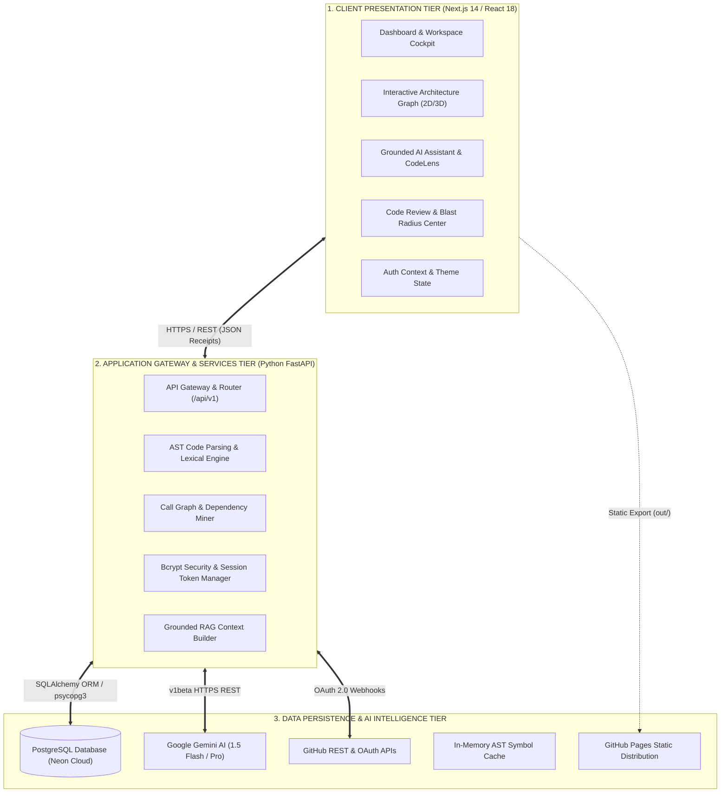

# CHAPTER 3 — SYSTEM ANALYSIS AND DESIGN

## 3.1 Existing System and Current Approaches
In contemporary software engineering environments, developers seeking to comprehend, navigate, and review unfamiliar or evolving codebases typically rely on a fragmented combination of three distinct classes of tools:

1. **Text-Based Pattern Search in Local IDEs**: Developers utilize standard text editors and IDEs (e.g., VS Code, IntelliJ IDEA) equipped with search utilities such as `ripgrep`, `grep`, or file-name indexers. While these tools locate exact string occurrences with high speed, they possess zero architectural or semantic awareness. Searching for a common method name such as `authorize()` returns dozens of false-positive text matches across comments, mock files, tests, and configuration strings without discerning the active execution flow.
2. **Traditional Static Analysis and Linter Suites**: Tools such as SonarQube, ESLint, and Pylint perform AST analysis to enforce syntactic conventions, identify common bug patterns, and calculate test coverage. However, these tools generate voluminous, static warning logs that fail to assist a developer who needs to understand how an unfamiliar microservice operates or how data propagates across distributed API routes.
3. **Unconstrained Generative AI Chatbots**: Engineers increasingly paste snippets of code into commercial AI chatbots (e.g., ChatGPT, Claude web interfaces) or prompt IDE autocomplete extensions. While capable of synthesizing high-level descriptions of isolated snippets, these models lack access to the global repository AST. When asked about multi-module architecture, they hallucinate nonexistent functions, invent incorrect parameters, and misstate caller hierarchies.

## 3.2 Limitations of Existing Approaches
The fundamental limitations of existing approaches are summarized below:
- **High Cognitive Overhead**: Developers must mentally integrate text search results, class definitions, and documentation to reconstruct execution flows.
- **Absence of Blast-Radius Mapping**: None of the existing tools automatically calculate the transitive downstream impact of a proposed modification across disparate modules.
- **High Rate of AI Hallucination**: Ungrounded LLM interactions routinely generate plausible-sounding falsehoods, requiring engineers to double-check every AI statement against the source code.
- **Architectural Opacity**: Visual representations of codebases are either completely absent or generated as static, offline diagrams that quickly fall out of sync with active Git branches.
- **Fragmented Developer Experience**: Developers are forced to switch constantly between command-line search tools, browser-based documentation, and external AI interfaces.

## 3.3 Proposed CodeAtlas System
The proposed **CodeAtlas Platform** unifies deterministic compiler analysis with multi-modal artificial intelligence into a cohesive, responsive web platform. CodeAtlas ingests codebases, parses source files into detailed Abstract Syntax Trees, maps bidirectional caller/callee relationships, detects circular dependencies, and renders interactive 2D graph and 3D city visualizations. Furthermore, CodeAtlas introduces **Grounded AST Retrieval-Augmented Generation**, where Google Gemini AI models are provided with exact AST symbol definitions and caller chains. Every explanation generated by CodeAtlas is accompanied by verifiable receipts—concrete file paths and line number ranges—enabling instant verification.

## 3.4 Functional Requirements
The CodeAtlas platform fulfills the following functional requirements (FRs):
- **FR-1: Multi-Provider Authentication**: The system shall support secure user registration and login using email/password (with 12-round bcrypt hashing), 6-digit email OTP verification, Google OAuth (OpenID Connect), and GitHub OAuth (OAuth 2.0).
- **FR-2: Repository Ingestion & Crawling**: The system shall recursively crawl repository directories, filtering out non-source files (`node_modules`, `.git`, binary assets, build artifacts).
- **FR-3: AST Symbol Extraction**: The system shall parse source code files across JavaScript, TypeScript, and Python to extract symbols including functions, classes, interfaces, routes, and decorators with exact line ranges.
- **FR-4: Bidirectional Call Graph Resolution**: The system shall resolve import statements and function invocations, mapping caller-to-callee and callee-to-caller relationships.
- **FR-5: Interactive Architecture Visualization**: The system shall render interactive 2D node-link dependency graphs and 2.5D isometric city views with node selection and clustering.
- **FR-6: Evidence-Grounded AI Code Assistant**: The system shall accept natural language questions regarding the codebase, assemble relevant AST subgraphs, query Google Gemini models, and stream answers containing exact file and line citations.
- **FR-7: Deterministic Offline AI Fallback**: In the absence of an external AI API key or network connectivity, the system shall synthesize structured technical explanations directly from the local AST symbol graph.
- **FR-8: PR Blast-Radius & Impact Analysis**: The system shall compute the transitive downstream dependency tree affected by modifications to a specific file or symbol.
- **FR-9: Guided Developer Onboarding**: The system shall generate structured reading sequences and architectural module overviews categorized by complexity to onboard new engineers.
- **FR-10: Global Multi-Category Search**: The system shall support fuzzy and exact search across symbols, files, routes, and documentation.

## 3.5 Non-Functional Requirements
- **NFR-1: Performance & Latency**: AST symbol extraction for repositories under 100,000 LOC shall complete within 30 seconds. Interactive graph rendering shall maintain a minimum of 60 FPS.
- **NFR-2: Cryptographic Security**: Passwords shall be hashed using bcrypt with at least 12 salt rounds. Session tokens shall be stored exclusively in `HttpOnly`, `SameSite=Lax`, and `Secure` cookies.
- **NFR-3: Reliability & Fault Tolerance**: API routes shall return standardized error responses without leaking internal stack traces or connection strings. Database disconnections shall produce HTTP 503 Service Unavailable responses.
- **NFR-4: Tenant Data Isolation**: All database queries for repositories, symbols, and connected accounts shall enforce tenant separation based on authenticated user IDs.
- **NFR-5: Responsive Design**: The frontend interface shall support responsive layouts across mobile (>=320px), tablet (>=768px), and desktop (>=1024px) viewports with seamless dark/light theme switching.

## 3.6 Feasibility Analysis
- **Technical Feasibility**: The platform leverages proven, mature technologies: Next.js 14 and React 18 for high-performance reactive UI rendering; Python 3.13 and FastAPI for asynchronous high-throughput backend APIs; SQLAlchemy and PostgreSQL for ACID-compliant relational persistence; and Google Gemini models for state-of-the-art multi-modal reasoning. Technical feasibility was comprehensively demonstrated through the implementation and passing of 237 automated tests.
- **Operational Feasibility**: CodeAtlas integrates smoothly into existing developer workflows. Developers can access the platform via any modern web browser without installing heavy local dependencies. The platform provides intuitive visual graphs, guided walk-throughs, and clear receipts, requiring minimal training.
- **Economic Feasibility**: The platform is constructed entirely using open-source frameworks (Next.js, FastAPI, PostgreSQL, Tailwind CSS, Lucide icons), incurring zero software licensing costs. Hosting utilizes free or low-cost serverless tiers: GitHub Pages for static frontend delivery, AWS Neon free tier for cloud PostgreSQL, and pay-as-you-go Google AI Studio API allocations. The substantial reduction in developer onboarding time (from weeks to days) delivers exceptional return on investment.

---

## 3.7 System Architecture
The system architecture of CodeAtlas is structured as a three-tier decoupled distributed architecture, illustrated in **Figure 3.1** (`report/diagrams/architecture/overall_system_architecture.png`).

1. **Client Presentation Tier (Next.js 14 & React 18)**: Hosted statically via GitHub Pages or rendered locally, providing the responsive user interface, Framer Motion animations, interactive SVG/canvas architecture graphs, theme state, and client-side authentication listeners.
2. **Application Gateway & Backend Tier (Python 3.13 & FastAPI)**: Asynchronous REST API server hosting 16 modular routers, CORS middleware, JWT validation gates, AST lexical analysis engines, and grounded prompt generators.
3. **Data Persistence & AI Intelligence Tier**: Comprises AWS Neon Cloud PostgreSQL for ACID relational storage, Google Gemini API for multi-modal code reasoning, and GitHub REST APIs for profile and repository synchronization.

---

## 3.8 Component and Module Design
The platform is organized into eight cohesive functional components:
- **Auth & Session Subsystem**: Manages password hashing, OTP lifecycle, OAuth redirects, state verification, and cookie serialization.
- **Repository Ingestor**: Handles repository connection, directory traversal, file filtering, and ingestion triggers.
- **AST Parsing Engine**: Analyzes source code files to extract symbol boundaries, function parameters, decorators, and imports.
- **Call Graph & Dependency Miner**: Connects symbol definitions with call expressions, traces caller/callee trees, and flags circular module dependencies.
- **AI Grounding & RAG Orchestrator**: Bridges developer natural language queries with verified AST evidence, managing prompt bounding and streaming.
- **Architecture Visualization Canvas**: Renders 2D interactive graphs with force-directed layouts and 2.5D isometric city models.
- **Code Review & Blast-Radius Engine**: Analyzes PR diffs to determine the transitive blast radius of code modifications.
- **Global Search Indexer**: Indexes symbol tables, file paths, and documentation for real-time multi-category search.

---

## 3.9 Use-Case Diagram
The platform use cases and actor interactions are depicted in **Figure 3.8** (`report/diagrams/architecture/use_case_diagram.png`).
- **Software Developer**: Interacts with the platform to register/login, connect repositories, explore AST call trees, ask grounded questions with source receipts, inspect architecture visualizers, and conduct search.
- **Tech Lead / Architect**: Analyzes codebase health scores, inspects circular dependency warnings, evaluates PR blast-radius impact, and designs guided onboarding learning paths.
- **System Administrator**: Manages platform configurations, monitors service health endpoints (`/api/v1/health`), and oversees database migrations.

---

## 3.10 Data-Flow Diagram (Level-1 DFD)
The data flows within CodeAtlas are illustrated in **Figure 3.9** (`report/diagrams/architecture/data_flow_diagram.png`).
1. **Flow 1 (Authentication)**: User credentials flow from Developer to Process 1.0 (*Authenticate & Authorize*), validating against Data Store D1 (*User Store*), which returns session tokens and sets HttpOnly cookies.
2. **Flow 2 (Code Ingestion)**: Repository source archives flow from Developer to Process 2.0 (*Ingest & Parse Repository*), which filters non-code files and streams clean source files to Process 3.0 (*Construct AST & Call Trees*).
3. **Flow 3 (Symbol Persistence)**: Extracted symbol definitions and caller/callee links are stored in Data Store D2 (*Symbol Store*) and Data Store D3 (*Graph Store*).
4. **Flow 4 (AI Reasoning)**: Developer natural language queries flow to Process 4.0 (*Ground AI Prompt with Context*), which fetches relevant symbol definitions from D2 and D3, formulates bounded prompts, queries Google Gemini, and returns cited answers.
5. **Flow 5 (Visualization)**: Process 5.0 (*Render Graph & Code Receipts*) consumes symbol and dependency data to render interactive visual graphs and clickable code receipts.

---

## 3.11 Database Design and Entity Relationships
The relational database schema is illustrated in **Figure 3.7** (`report/diagrams/database/database_er_diagram.png`). The schema enforces strict referential integrity and multi-tenant isolation across five core relational tables:

1. **`users` Table**:
   - `id` (UUID, Primary Key): Unique internal user identifier.
   - `email` (VARCHAR(255), Unique Index `ix_users_email`): Normalized email address.
   - `hashed_password` (VARCHAR(255), Nullable): 12-round bcrypt password hash (null for pure OAuth users).
   - `display_name` (VARCHAR(255), Not Null): User's full name.
   - `avatar_url` (TEXT, Nullable): URL to profile avatar image.
   - `is_active` (BOOLEAN, Default True): Account active flag.
   - `is_verified` (BOOLEAN, Default False): Email OTP verification status.
   - `created_at` / `updated_at` (TIMESTAMP With Time Zone): Audit timestamps.

2. **`connected_accounts` Table**:
   - `id` (UUID, Primary Key): Unique account connection identifier.
   - `user_id` (UUID, Foreign Key -> `users.id` ON DELETE CASCADE): Parent user.
   - `provider` (VARCHAR(50)): OAuth provider identity (`google` or `github`).
   - `provider_user_id` (VARCHAR(255)): Provider's unique user ID.
   - `access_token` (TEXT): Encrypted OAuth bearer token.
   - `scopes` (TEXT[]): Authorized OAuth permission scopes.
   - `created_at` (TIMESTAMP): Connection timestamp.

3. **`repositories` Table**:
   - `id` (VARCHAR(100), Primary Key): Unique repository identifier.
   - `user_id` (UUID, Foreign Key -> `users.id` ON DELETE CASCADE): Owner tenant ID.
   - `name` / `full_name` (VARCHAR(255)): Repository name (e.g., `payment-service`).
   - `owner` (VARCHAR(255)): GitHub owner or organization name.
   - `connection_type` (VARCHAR(50)): Connection origin (`github` or `local`).
   - `is_indexed` (BOOLEAN, Default False): AST indexing completion status.
   - `file_count` / `symbol_count` (INTEGER): Codebase volumetric metrics.

4. **`code_symbols` Table**:
   - `id` (UUID, Primary Key): Unique symbol identifier.
   - `repository_id` (VARCHAR(100), Foreign Key -> `repositories.id` ON DELETE CASCADE).
   - `name` (VARCHAR(255), Indexed): Symbol identifier (e.g., `authorize`).
   - `kind` (VARCHAR(50)): Symbol type (`function`, `class`, `interface`, `route`).
   - `file_path` (TEXT): Relative file path within repository.
   - `start_line` / `end_line` (INTEGER): Exact 1-based source line range.
   - `callers` (JSONB): Array of symbol IDs invoking this symbol.
   - `callees` (JSONB): Array of symbol IDs invoked by this symbol.

5. **`dependencies` Table**:
   - `id` (UUID, Primary Key): Dependency record identifier.
   - `repository_id` (VARCHAR(100), Foreign Key -> `repositories.id` ON DELETE CASCADE).
   - `source_module` / `target_module` (VARCHAR(255)): Origin and destination modules.
   - `dependency_type` (VARCHAR(50)): Coupling type (`import`, `api`, `rpc`).
   - `is_circular` (BOOLEAN, Default False): Circular dependency flag.

---

## 3.12 API Design
The CodeAtlas backend exposes 16 structured REST routers mounted under the `/api/v1` namespace. Key endpoint contracts include:
- `POST /api/v1/auth/register`: Accepts `{name, email, password}`; validates uniqueness, hashes password, generates OTP, returns HTTP 201.
- `POST /api/v1/auth/login`: Accepts `{email, password}`; verifies bcrypt hash, returns user profile and sets session cookie.
- `POST /api/v1/auth/verify-otp`: Accepts `{email, otp_code}`; verifies 6-digit code, marks user verified, returns session cookie.
- `GET /api/v1/auth/session`: Validates session cookie, returns active user claims or unauthenticated status.
- `GET /api/v1/repositories/{id}/symbols/navigate`: Returns AST symbol coordinates, line ranges, and caller/callee trees.
- `POST /api/v1/assistant/query`: Accepts `{question, repository_id, selected_symbol}`; streams grounded AI responses with source receipts.
- `GET /api/v1/architecture/{id}/graph`: Returns nodes, edges, circular dependency flags, and structural health scores.

## 3.13 Authentication and Authorization Design
The complete interaction and security flows are detailed in **Figure 3.2**, **Figure 3.3**, and **Figure 3.4**:
- **Email/Password**: Utilizes 12 salt rounds of bcrypt hashing. Passwords are never stored in plaintext and never serialized in API responses.
- **Email OTP Verification**: Generates cryptographically random 6-digit numeric OTPs with a 10-minute time-to-live (TTL), single-use atomic invalidation, and a 60-second resend cooldown.
- **OAuth 2.0 & OpenID Connect**: Initiates OAuth authorization flows with cryptographically generated `state` parameters stored in `codeatlas_oauth_state` HttpOnly cookies to prevent Cross-Site Request Forgery (CSRF). Upon callback receipt, the backend securely exchanges the authorization code for an access token, verifies identity claims, and binds or creates the corresponding user record.
- **Session Tokens**: Issues HS256-signed JWT access tokens stored exclusively in `HttpOnly`, `SameSite=Lax` cookies, protecting against both XSS token exfiltration and CSRF attacks.

## 3.14 Security and Privacy Considerations
- **No Training On User Code**: User codebases and AST representations are never transmitted to third parties for model fine-tuning or AI training.
- **Sanitized Error Handlers**: Global exception handlers intercept all unhandled exceptions and database errors, logging detailed diagnostic traces internally while returning sanitized, generic HTTP 500 or HTTP 503 JSON payloads to prevent database credential or connection string leakage.
- **Strict Tenant Isolation**: All database operations filter records by `user_id`, preventing cross-user data leakage.
- **Static Export Secret Protection**: The Next.js static build pipeline was audited and verified to ensure that zero private keys, Gemini API keys, GitHub client secrets, or database URLs exist in generated static distribution assets.

